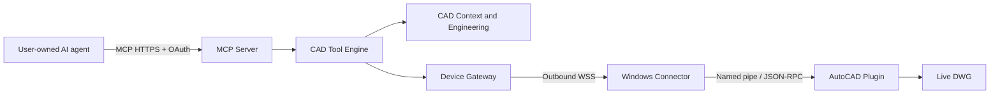

# Aleph Connector target architecture

## Decision

Aleph Connector is a private-source, cloud-managed, BYOAI product published through `alephhq.tech`. The product name does not require a separate public domain.

Aleph Connector is not an agent engine. User-owned agents perform language understanding and planning. Aleph Connector supplies authenticated CAD evidence, deterministic engineering computation, validated operations, execution, and receipts.

## Runtime boundary

### Cloud

- MCP resource server and OAuth integration
- account, client, device, grant, scope, and licensing policy
- semantic CAD tools and validated schemas
- revision-bound CAD context and short-lived geometry indexes
- private geometry and engineering algorithms
- device routing, execution ledger, reconciliation, and audit metadata

### Windows

- outbound authenticated device connection
- AutoCAD process and plugin health discovery
- local IPC routing
- Autodesk .NET API reads and typed writes
- main-thread execution, document locks, transactions, rollback, undo, capture, and receipts

## Identity model

MCP client and device identities are different principals.

- An **MCP client credential** authorizes a user-owned agent for scopes such as `cad:read`, `cad:write`, `cad:file`, and `cad:admin`.
- A **device credential** authorizes one Connector to establish a relay connection after explicit pairing.
- Dispatch requires both an authorized caller-to-device grant and a live device session.
- Neither credential is accepted in place of the other.

## Stateless MCP handles

Protocol-level MCP sessions are not product state. Aleph Connector issues explicit, expiring, owner-bound handles:

- `documentRef`: user, device, instance, document identity, layout, revision, expiry
- `planId`: validated preview, source revision, operation digest, policy result, expiry
- `executionId`: idempotent write identity and durable reconciliation key

Handles are opaque to clients. Every use revalidates ownership, scope, expiry, and current document identity. A model cannot select another user's device by changing a tool argument.

## Write path

1. Authorize MCP client, scope, and device grant.
2. Resolve `documentRef`; reject stale or ambiguous identity.
3. Validate the typed operation batch and engineering policy.
4. Reserve `executionId`/`idempotencyKey` before dispatch.
5. Serialize writes per document; bounded reads may run concurrently.
6. Connector routes the request to the correct AutoCAD process and plugin.
7. Plugin rechecks document identity and revision, locks the document, and executes on AutoCAD's main thread.
8. Persist the execution receipt before returning success.
9. Verify handles, entity state, revision, and optional visual evidence.

A timeout after dispatch is `unknown`, not `failed`. Reconcile the receipt before any retry.

## Commit and verification truth

Commit and verification are separate facts:

- `committed=true, verified=true`: write committed and read-back evidence matched.
- `committed=true, verified=false`: write committed; visual or geometric verification was incomplete.
- `committed=false`: no write was committed.
- `state=unknown`: dispatch outcome must be reconciled.

Never report a rollback, single transaction, save, or visual verification unless the plugin receipt proves it.

## Privacy

- No DWG content, geometry payload, captured image, credential, or model reasoning in default logs.
- Cloud requests only the required region and fields; caches are revision-bound and time-limited.
- Product UI discloses when CAD data or captures may be forwarded by the user's agent to a third-party model.
- File operations are confined to explicit, user-authorized path grants.

## Scale boundary

MVP may run MCP HTTP and WSS relay in one Bun process with PostgreSQL. WSS routing is stateful even though MCP HTTP is stateless. Before horizontal fan-out, move execution receipts and plan/region state to durable shared storage and add connection affinity or a shared device-routing layer.
