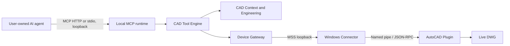

# Aleph Connector target architecture

## Decision

Aleph Connector is a local-first product: one Windows application, one local runtime, no Aleph
account, no cloud server, no Aleph API key. The user's own agent (Claude, Codex, Antigravity,
Cursor, VS Code) performs language understanding and planning. Aleph Connector supplies CAD
evidence, deterministic engineering computation, validated operations, execution, and receipts —
all on the user's machine.

## Runtime boundary

### Local runtime (one Bun process, 127.0.0.1)

- MCP resource server on `/mcp` (Streamable HTTP) plus the bundled stdio proxy executable
- Device Gateway WSS on `/device` for the Windows Connector
- `/health` runtime status
- semantic CAD tools and validated schemas
- revision-bound CAD context and geometry indexes on SQLite (`cad-state` + `data`)
- geometry and engineering algorithms
- device routing, execution ledger, reconciliation, and audit metadata
- local trust custody: runtime secret, device grant file, Bridge device credential

### Windows

- loopback authenticated device connection
- AutoCAD process and plugin health discovery
- local IPC routing
- Autodesk .NET API reads and typed writes
- main-thread execution, document locks, transactions, rollback, undo, capture, and receipts

## Identity model

There is no account layer. Two local principals remain distinct:

- The **MCP caller** is the fixed local principal (`local/local`). Transport protection is the
  loopback guard: the runtime binds 127.0.0.1 and rejects any non-loopback `Host` or cross-origin
  `Origin` (DNS-rebinding defense). Product-level approval (read-only default, explicit edit
  toggle) lives in the desktop application, not in tokens.
- A **device credential** (ABT, HMAC-signed, locally minted) authorizes one Connector to establish
  the loopback relay connection. Socket reachability is never authorization: the Connector
  authenticates on `/device` and every dispatch rechecks the live grant generation.

The runtime owns the secret, the grant file, and a stable deviceId under its state directory
(default `%LOCALAPPDATA%\CadAI\connector\`), and writes the credential to the
`bridge\identity.json` the Connector already reads.

## Stateless MCP handles

Protocol-level MCP sessions are not product state. Aleph Connector issues explicit, expiring,
owner-bound handles:

- `documentRef`: device, instance, document identity, layout, revision, expiry
- `planId`: validated preview, source revision, operation digest, policy result, expiry
- `executionId`: idempotent write identity and durable reconciliation key

Handles are opaque to clients. Every use revalidates ownership, expiry, and current document
identity.

## Write path

1. Resolve `documentRef`; reject stale or ambiguous identity.
2. Validate the typed operation batch and engineering policy.
3. Reserve `executionId`/`idempotencyKey` before dispatch.
4. Serialize writes per document; bounded reads may run concurrently.
5. Connector routes the request to the correct AutoCAD process and plugin.
6. Plugin rechecks document identity and revision, locks the document, and executes on AutoCAD's
   main thread.
7. Persist the execution receipt before returning success.
8. Verify handles, entity state, revision, and optional visual evidence.

A timeout after dispatch is `unknown`, not `failed`. Reconcile the receipt before any retry.

## Commit and verification truth

Commit and verification are separate facts:

- `committed=true, verified=true`: write committed and read-back evidence matched.
- `committed=true, verified=false`: write committed; visual or geometric verification was incomplete.
- `committed=false`: no write was committed.
- `state=unknown`: dispatch outcome must be reconciled.

Never report a rollback, single transaction, save, or visual verification unless the plugin receipt
proves it.

## Privacy

- No DWG content, geometry payload, captured image, credential, or model reasoning in default logs.
- The runtime only requests the required region and fields; caches are revision-bound and
  time-limited.
- Product UI discloses when CAD data or captures may be forwarded by the user's agent to a
  third-party model.
- File operations are confined to explicit, user-authorized path grants.

## Scale boundary

The local runtime runs MCP HTTP and the WSS device relay in one Bun process with SQLite. WSS
routing is stateful even though MCP HTTP is stateless. This is the intended single-machine shape;
horizontal fan-out is out of scope for the local-first product.
