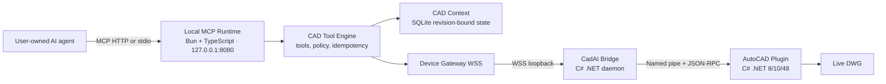

# Aleph Connector — Workflow Reference

> Self-contained map of how Aleph Connector works end-to-end, so an agent can orient in the
> system without re-reading the source. Every statement here is grounded in the current code and
> docs; where something is not yet verified end-to-end it is marked **[unverified]**.

## What it is

Aleph Connector is a **local-first** Windows product that connects a user's own AI agent to a
live AutoCAD DWG. There is no account, no cloud relay, no Aleph API key. The user's AI agent
(Claude Desktop, OpenAI Codex CLI, Google Antigravity, Cursor, VS Code) supplies all language
understanding and planning. Aleph Connector supplies:

- evidence and context (what the drawing actually says),
- deterministic engineering computation (PCCC layouts, hydraulics),
- typed, schema-validated, transactional CAD operations with receipts.

Nothing leaves the machine by default.

## Architecture



- **Local MCP runtime** (`apps/mcp-server`) — one Bun process bound to `127.0.0.1`. Serves the
  MCP Streamable HTTP endpoint plus an internal WSS device gateway; owns CAD State, geometry
  and engineering algorithms, the execution ledger and the trust custody (runtime secret, grant
  file, Bridge device credential).
- **Windows Bridge** (`windows/connector`) — background C# daemon. Monitors AutoCAD processes,
  owns the named-pipe IPC to plugins, repairs the plugin, self-updates.
- **AutoCAD Plugin** (`windows/autocad-plugin`) — sits inside AutoCAD, executes every read/write
  on AutoCAD's main thread via the official .NET API.
- **Desktop app** (`windows/connector-app`) — Tauri v2 + React + Rust. Owns the runtime process
  and the install/config flows.

The Tauri app is the lifecycle owner: it spawns the runtime sidecar (or `bun run src/index.ts`
in a fresh dev checkout), supervises it, and kills it on exit.

## The three lifecycle flows

### 1. Install / first-run

```text
1. User downloads AlephConnector.exe (NSIS) or .msi and runs it
2. Desktop app detects the installed AutoCAD version (AutoCAD 2021 → 2027+)
3. Desktop app runs install.ps1 → installs the bridge task + the AutoCAD bundle (plugin)
4. Bridge service starts (Task Scheduler), registers TRUSTEDPATHS, loads the plugin
5. Agents are selected in the UI
   - Claude Desktop  → bundled stdio bridge exe (aleph-mcp-stdio.exe), no npx/network
   - Claude Code CLI → `claude mcp add --transport http`
   - Codex CLI      → writes/updates [mcp_servers."aleph-connector"] in ~/.codex/config.toml
   - Cursor/VS Code → loopback URL http://127.0.0.1:8080/mcp
   - Antigravity    → loopback URL (own config shape, with backup protection)
6. "Install Agent Pack" deploys AGENTS.md + skills (autocad-drafting, pccc-fire-alarm-design)
   into each selected agent's directory
```

### 2. Runtime lifecycle

```text
Desktop app starts → runtime sidecar spawned (aleph-mcp.exe)
  → runtime mints its local trust secret + grant file
  → Bridge credential written to the bridge identity.json
  → runtime binds 127.0.0.1:<port> (/mcp, /device, /health)
Desktop app closes → RunEvent::Exit → runtime::stop() → sidecar killed, port freed
Runtime crash       → supervisor loop (1→30s backoff) → respawn or give up
Hard kill           → sidecar survives; next launch reaps stale aleph-mcp.exe on the port
                      (only that process name — never anything else)
```

### 3. Using the system (the steady state)

The agent drives everything through MCP tools. It is never told to "run shell commands": all
operations go through typed tools.

```text
Agent → MCP tool call → validation → dispatch → plugin execution → receipt → verification
```

## The read path (context, geometry, state)

1. Agent calls `context` first (or `system` / `guide`) to learn what is online.
2. `context` returns every online AutoCAD instance, the open documents on the resolved
   instance, and which one is active/pinned — 2+ instances means every AutoCAD-touching tool
   needs an explicit `instanceId`.
3. `drawing.inspect_floorplan` reads the revision-bound CAD State snapshot (SQLite,
   rebuilt on demand by the scan path) so the agent knows rooms/dimensions without walking the
   DWG a second time — the same snapshot is reused by the PCCC overlay tool.
4. Geometry indexes and region caches live in the same revision-bound SQLite store; a stale
   revision is never trusted.

Read tools are read-only, idempotent and annotated accordingly.

## The write path (the core sequence)

Every mutation goes through this sequence (see `docs/architecture.md` for the full contract):

```text
1. Resolve documentRef      — reject stale or ambiguous identity
2. Validate the typed batch — schema + engineering policy (geometry rules)
3. Reserve executionId      — idempotency key reserved BEFORE dispatch
4. Serialize writes        — one writer per document; bounded reads may run concurrently
5. Dispatch to the Bridge  — device Gateway WSS → capability routing
6. Plugin rechecks          — document identity + revision, re-validates before executing
7. Lock + execute         — on AutoCAD's main thread, inside an explicit transaction
8. Persist the receipt    — before success is reported
9. Verify                 — read back entity state / revision, optional visual evidence
10. Report                — with commit AND verification facts kept separate
```

**Commit and verification are separate facts.** Never report a rollback, a single transaction,
a save or a visual verification unless the plugin receipt proves it.

**A timeout after dispatch is `unknown`, not `failed`.** Reconcile the receipt before retrying
— never blind-retry a write.

Handles are protocol-level opaque objects, not product state:

| Handle | Meaning | Expiry / ownership |
|---|---|---|
| `documentRef` | device, instance, document identity, layout, revision | expiring, owner-bound |
| `planId` | validated preview + policy result + operation digest | expiring |
| `executionId` | idempotent write identity + durable reconciliation key | idempotent |

Every handle use revalidates ownership, expiry and current document identity.

## The PCCC special path

Vietnamese fire-alarm (PCCC) work has its own tool surface and overlay:

```text
Agent → guide topic "pccc" → pccc-fire-alarm-design skill
      → pccc_fire_alarm_overlay / pccc_overlay (MCP tools)
      → packages/engineering: sprinkler layout, pipe router, connectivity,
        hydraulic engine, fire-alarm types, structural-highway router, block library
      → CAD-geometry gates (the overlay tool is the only entry point)
      → plugin
```

The low-level planners (`fire-alarm-layout`, `fire-alarm-planner`) are intentionally **not**
re-exported from `@aleph-connector/engineering`: the agent cannot skip the CAD-geometry gates
by importing them directly. The overlay tools are the only entry point.

## The MCP tools

Every tool is `guarded` (typed, schema-validated) and returns text results. Registered tools:

| Tool | Purpose |
|---|---|
| `guide` | AutoCAD drafting skill + PCCC reference/skills (call before drawing) |
| `context` | Session context: devices, AutoCAD instances, documents, active/pinned doc |
| `system` | Plugin diagnostics (versions, process id, active document, pipe uptime) |
| `drawing` | Inspect geometry, floorplan snapshot, regions |
| `cad` | CAD State scan / changes |
| `entity` | Create/modify/read entities |
| `edit` | Safe entity editing |
| `layer` | Layers |
| `block` | Block definitions |
| `style` | Symbol tables (linetypes, text styles, dimension styles) |
| `construct` | Walls, grid, room, dimension chains |
| `operations` | Batch operations + undo |
| `view` | View/zoom/extents (read) |
| `pccc_overlay` | PCCC overlay executor (sprinkler layout + pipe network in one plan) |
| `pccc_fire_alarm_overlay` | PCCC fire-alarm one-shot executor |

Guide prompts and skills (`autocad://guide/drafting/SKILL.md`, PCCC) are also readable as MCP
resources; the `guide` tool is the canonical source of the workflow rules — do not restate them
in agent instructions.

## The Bridge (Windows daemon)

`CadAI.Bridge.exe` is a single-instance background daemon (no tray, no window). Its wiring:

```text
AutoCadProcessMonitor discovers AutoCAD instances
  → CapabilityRegistry snapshots what each plugin offers
  → report via Gateway capability.update
Bridge receives capability.execute from the runtime
  → IpcRouter dispatches to the right AutoCAD process (named pipe)
  → plugin executes and returns capability.result
```

Other responsibilities:

- `AutoCadTrustedPaths` — registers the bundle path in AutoCAD's TRUSTEDPATHS so the plugin
  autoloads on the first AutoCAD launch after install (HKCU, user-writable).
- `PluginRecoveryService` — repairs the bundle if it is missing/dropped in.
- `BridgeHealthReporter` — writes machine-readable `health.json` + rolling logs under
  `%ProgramData%\CadAI\bridge\logs`.
- `UpdateCoordinatorService` — self-update via signed manifest + public-key verify.
- `SingleInstanceGuard` — exactly one Bridge per machine.

## The desktop app (Tauri v2 + React + Rust)

| Tab | Does |
|---|---|
| Runtime | Auto-starts the runtime sidecar on launch; shows port/health/URLs; Restart / Stop; supervisor loop restarts a dead runtime with 1→30s backoff |
| AutoCAD | Detect version; Install / Repair / Uninstall bridge + plugin; version compare; check + apply updates (signed manifest, public-key verify) |
| Agents | Detect installed agents on the machine; write MCP config; Install Agent Pack (AGENTS.md + skills) |
| Logs | Live log of runtime and UI actions |

It owns exactly one runtime child process. The `Stop` button and app exit both kill the
sidecar; the supervisor only auto-restarts **unexpected** exits. Stale sidecars left behind by
hard kills are reaped on next launch (only `aleph-mcp` / `aleph-mcp.exe`, never anything else).

## The trust model

- **No account layer.** The fixed local principal is `local/local`.
- **Loopback only.** The runtime binds `127.0.0.1`; non-loopback Host headers or cross-origin
  Origins are rejected (DNS-rebinding defense). Product-level approval (read-only default,
  explicit edit toggle) lives in the desktop app, not in tokens.
- **Device credential.** A locally minted HMAC device token authorizes one Bridge connection to
  `/device`. Socket reachability is never authorization — every dispatch rechecks the live grant
  generation.
- The **runtime owns** the secret, the grant file and the Bridge device credential (written to
  the `identity.json` the Bridge reads). The desktop app never handles credentials.

## Where state lives

| State | Location |
|---|---|
| Runtime secret + grant store | `%LOCALAPPDATA%\CadAI\connector\` (env override: `ALEPH_LOCAL_STATE_DIR`) |
| Bridge device credential | `%LOCALAPPDATA%\CadAI\bridge\identity.json` |
| CAD State SQLite | `cad-state.db` (revision-bound snapshots, rebuilt on demand) |
| Bridge logs + health | `%ProgramData%\CadAI\bridge\logs` + `health.json` |
| Agent MCP configs | `~/.codex/config.toml` (Codex), Claude Desktop config, Cursor/VS Code settings |

## How to verify the system works

- `curl http://127.0.0.1:8080/health` → `{"status":"ok","auth":"local","deviceId":"..."}`
- `context` MCP tool → online instances + open documents
- `system` MCP tool → plugin status (version, pid, uptime)
- Desktop app **Runtime** tab → port / health / MCP URL / Bridge WSS
- Desktop app **Logs** tab → runtime and UI activity
- Bridge logs: `%ProgramData%\CadAI\bridge\logs` + `health.json`

## Key files

| Area | File(s) |
|---|---|
| Runtime entry | `apps/mcp-server/src/index.ts` |
| HTTP + WSS routing | `apps/mcp-server/src/app.ts` |
| MCP session wiring | `apps/mcp-server/src/server.ts` |
| Tool registration | `apps/mcp-server/src/tools/index.ts` |
| Runtime lifecycle + sidecar | `windows/connector-app/src-tauri/src/runtime.rs` |
| Desktop app | `windows/connector-app/src/App.tsx` |
| Bridge entry | `windows/connector/Program.cs` |
| Plugin entry | `windows/autocad-plugin/PluginEntryPoint.cs`, `PipeServer.cs` |
| IPC dispatch | `windows/connector/IPC/IpcRouter.cs` |
| AutoCAD discovery | `windows/connector/Device/AutoCadProcessMonitor.cs` |
| Engineering core | `packages/engineering/src` |
| CAD tools | `packages/cad-tools/src` |
| CAD State store | `packages/cad-state/src` |
| Trust / identity | `packages/identity/src` |
| Device protocol | `packages/cad-protocol/src` |

## Boundaries and current limits

- The runtime runs a single Bun process with SQLite — a single-machine shape by design;
  horizontal fan-out is out of scope.
- Desktop app and runtime are not yet exercised end-to-end on every supported AutoCAD
  generation in CI **[unverified]** — the dev-verified path is Windows + AutoCAD 2021–2024
  (net48 and net8.0-windows builds; net10.0-windows requires the .NET 10 SDK and
  `-RequireAllGenerations`).
- Live DWG behavior (actual AutoCAD writes against a real drawing) is **[unverified]** in this
  document's author; it is covered by the plugin's .NET tests and the repo's live E2E lane.

## See also

- `docs/architecture.md` — full target-architecture contract (write path, commit/verify truth)
- `docs/windows-distribution.md` — install/update/trust model
- `docs/e2e-live.md` — live E2E lane
- `packages/agent-pack/AGENTS.md` — how agents should use the system
